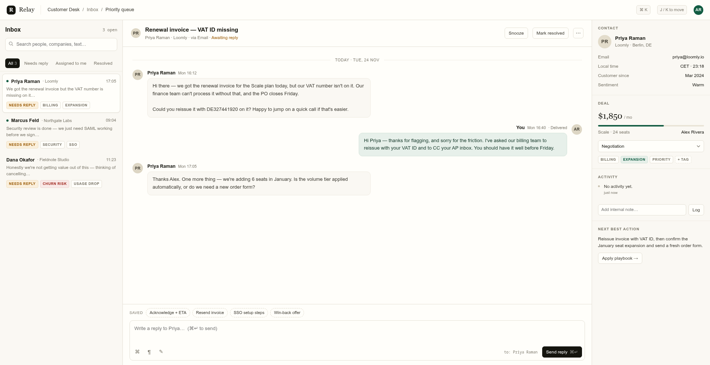

<div align="center">

# Relay

**A customer-support agent with memory — OpenCode + Browse MCP + SQLite.**


</div>



> **Status:** working prototype. The engine, policy gate, monitoring and self-tests are
> tested against the bundled demo desk. HubSpot, Intercom and Zendesk connectors are
> templates until verified against a real workspace — they ship marked `verified: false`
> on purpose. GoHighLevel is browser-only (no API or webhook) and is also unverified.

Relay is not another chatbot bolted onto a CRM. It is the **memory and policy layer** for
an OpenCode agent that drives your real, already-logged-in browser through
[Browse MCP](https://github.com/opencode/browse). The model writes the reply. The browser
presses send. Relay makes sure the agent knows the customer, keeps its promises, and cannot
quietly do something dumb at 3am.

## Why

- **Context windows forget promises.** "I said the invoice would be reissued before Friday"
  is a SQL row here, not a hope.
- **A CRM UI is a bad place to keep state.** Selectors drift, tabs close, sessions expire.
  The durable facts live in SQLite, the brittle parts in swappable connector files.
- **Autonomy without gates is an incident.** Money, legal, security and VIP threads are
  blocked in code, not by asking the model nicely.

## How it works

```
        ┌──────────────────────────── OpenCode ────────────────────────────┐
        │  read context, write the reply, choose the next move              │
        └───────┬───────────────────────────────┬──────────────────────────┘
                │ Browse MCP                    │ relay CLI
                ▼                               ▼
   ┌─────────────────────────┐        ┌──────────────────────────┐
   │ CRM in your real browser│        │ SQLite memory            │
   │ HubSpot / Intercom /    │        │ customers · threads      │
   │ Zendesk / anything web  │        │ promises · tasks · drafts│
   └─────────────────────────┘        │ feedback · lessons · audit│
                                      └──────────────────────────┘
```

Three rules keep it honest:

1. **Read the live thread before replying.** If the CRM and Relay disagree, the CRM wins.
2. **Verify in the DOM, then record.** Never the other way around.
3. **Policy is enforced by `relay send`,** not by prompt wording.

## What's in the box

- **Durable customer memory** — accounts, contacts, threads, messages, commitments, tasks,
  drafts, feedback, lessons, audit events.
- **Explainable priority queue** — revenue × wait time × sentiment × tags × SLA × account
  health. Every point has a reason you can read.
- **Policy gate** — `suggest` / `approve` / `auto`, sensitive-tag and phrase detection, VIP
  threshold, word limit, daily cap, consecutive-send refusal.
- **Live monitoring** — webhook receiver, idempotent snapshot diffing, reopen detection,
  SLA/ownership/promise alerts.
- **Identity and learning** — `soul.md`, `script.md`, and a feedback → lesson → promotion
  loop that changes behavior without self-editing the soul.
- **Self-maintenance** — connector profiles, `doctor`, regression suite, git-gated
  self-edits.

## Quickstart

Requirements: Python 3.10+, git, and (for the agent) OpenCode + Browse MCP.

```bash
git clone https://github.com/totti786/relay-crm-agent.git
cd relay-crm-agent

./relay init
./relay seed-demo --reset
./relay doctor
./relay selftest          # 9 tests, no browser required
./relay brief
./relay queue
```

### Windows

The engine is stdlib Python and runs natively. Use `py -3` in front of the script; `./relay`
is a POSIX shorthand. The script forces UTF-8 for its streams and file reads, so `→`, `●`
and `·` no longer crash on a cp1252 console. `-X utf8` is belt-and-braces on older setups:

```powershell
py -3 -X utf8 relay init
py -3 -X utf8 relay seed-demo --reset
py -3 -X utf8 relay doctor
py -3 -X utf8 relay selftest
py -3 relay brief
py -3 relay queue
```

The HTML demos run in any browser:
`py -3 -m http.server 8765 -d demo`.

Set environment variables in PowerShell with `$env:NAME = "value"` (for example
`$env:RELAY_DB`, `$env:RELAY_DRAFT_ONLY` or `$env:RELAY_WEBHOOK_SECRET`).

`relay serve --on-change` uses `sh -c` and `rm -f`; it is not supported natively on
Windows. Run `relay serve` without `--on-change` and poll with `relay sync`, or run the
whole stack under WSL. The GoHighLevel browser-only watch does not use this hook. The
browser bridge itself is Browse MCP; confirm its installer supports your Windows setup.

The repo includes the demo desk the screenshot comes from, plus a self-contained
interactive console that walks the whole loop:

```bash
python3 -m http.server 8765 -d demo
# desk:    http://localhost:8765
# console: http://localhost:8765/relay-console.html
```

Then install the browser bridge and start the agent:

```bash
browse install -a opencode -y
opencode
```

First prompt:

> Read `AGENTS.md`, `soul.md`, `script.md` and `PLAYBOOK.md`. Work the queue on
> http://localhost:8765. Stop at a draft for the billing thread.

## The loop

```bash
./relay soul --with-lessons      # identity + promoted lessons
./relay script                   # conversation arc and scenarios
./relay brief                    # what matters today
./relay queue --json             # ranked work
./relay thread t-priya           # full context bundle
#  ... Browse: read the live thread, snapshot, draft ...
./relay check t-priya --text "…" # auto-send or needs approval?
./relay draft / approve / send   # gated send
./relay due                      # promises and follow-ups
```

`send` records the outbound message, clears the waiting clock and SLA, schedules a
follow-up task, and stores any promise with a due date. A second consecutive send is
refused unless `--force`.

### Autonomy

`config.json` controls the gate. The default is `auto` for low-risk replies only:

```json
{
  "autonomy": "auto",
  "risky_tags": ["billing", "security", "churn risk", "legal", "contract", "vip"],
  "approval_phrases": ["refund", "discount", "contract", "dpa", "soc 2", "roadmap", "cancel"],
  "pacing": { "min_seconds_between_sends": 20, "max_sends_per_hour": 20 }
}
```

Test the policy before sending:

```bash
./relay check t-priya --text "The invoice is reissued and attached."
# {"decision":"requires_approval","reasons":["sensitive thread: billing"]}
```

## Live monitoring

Push is better than a faster poll.

```bash
RELAY_WEBHOOK_SECRET=… ./relay serve --port 8787 \
  --on-change ./examples/on-change.sh
```

```
POST /hook   X-Relay-Secret: …
{"threads":[ … ]}          → idempotent sync (new chats, replies, reopens)
{"account":…,"thread":…}   → single-message ingest
GET /health
```

The receiver returns `{"ok":true,"changed":true|false}`. The on-change hook starts **one**
draft-only agent run (serialized by a lock) and sets `RELAY_DRAFT_ONLY=1`, so the run can
read and draft but `relay send` refuses. Without a webhook, poll a snapshot every 2–5
minutes with `relay sync`. If the workspace forbids API access — GoHighLevel — use the
browser-only watch loop in `examples/gohighlevel-watch.md`.

`relay alerts --json --fail-on-breach` exits 3 on an SLA breach or overdue promise, which
is what a notifier should key off.

## Identity and learning

`relay soul` prints `soul.md`: name, values, voice, truth rules, hard limits, and a pre-send
self-check. `relay script` prints the conversation arc, state machine, ten scenario scripts,
handoff contract and quality rubric.

Corrections do not silently rewrite the agent:

```bash
./relay feedback t-dana --rating 3 --source human --tags tone \
  --note "sounded like a retention pitch, not curiosity"

./relay lesson add --scope flow \
  --text "When a reply covers two asks, open with one sentence that acknowledges both." \
  --evidence t-priya,t-marcus

./relay lesson promote 1 --by you
./relay learn
```

Active lessons load with `relay soul --with-lessons` on the next shift. Promotion is a
human decision; one strange customer never becomes policy.

## Adapting to a CRM

All CRM-specific knowledge lives in `connectors/<crm>.json` — URLs, locators, flows,
quirks, guardrails. Start with the closest of `gohighlevel`, `hubspot`, `intercom`,
`zendesk`, `demo`, then verify it read-only:

```bash
./relay doctor --connector hubspot
./relay connector hubspot

# GoHighLevel (browser-only)
./relay doctor --connector gohighlevel
./relay connector gohighlevel
```

GoHighLevel is intentionally browser-only: no OAuth, API or webhook. The agent polls the
Conversations UI, writes a normalised snapshot and runs `relay sync`. See
`examples/gohighlevel-watch.md`; the connector is `connectors/gohighlevel.json`. Polling is
slower and selector drift is real; `verified: false` stays until a read-only dry run on
your sub-account.

`doctor` fails if a connector is missing the controls a send loop needs. The validation
loop is in `PLAYBOOK.md` §10: observe with Browse → smallest patch → `doctor` +
`selftest` → dry run → human merge.

| Layer | The agent may | Gate |
|---|---|---|
| connector selectors/flows | edit | `doctor` + live dry run |
| `relay` core / schema | patch | branch + `selftest` + human merge |
| `tests/` | add | must pass |
| soul / script / policy | propose only | human edits |

`code_autonomy` defaults to `branch`. The agent can improve its operation, not its
boundaries: it cannot widen policy, skip post-send verification, hide that it is an AI, or
add delays to evade detection. Those are listed as forbidden in `AGENTS.md`.

## Commands

| Command | Purpose |
|---|---|
| `relay brief` | Today: queue, at-risk revenue, promises due |
| `relay queue [--json]` | Ranked work with reasons |
| `relay thread <id>` | Full context bundle for one thread |
| `relay check <id> --text` | Dry-run the autonomy policy |
| `relay draft / approve / send` | Approval-gated reply flow |
| `relay log / resolve` | Notes, commitments, stage, close |
| `relay due` / `relay alerts` | Deadlines, breaches, unowned chats |
| `relay sync <snapshot>` / `relay ingest` | Poll diff / single payload |
| `relay serve` | Webhook receiver + optional draft-only hook |
| `relay feedback / lesson / learn` | Learning loop |
| `relay soul / script` | Identity and conversation script |
| `relay doctor / selftest` | Validate before shipping a change |

## Repo layout

```
relay              CLI (Python stdlib, one file)
soul.md            identity, voice, truth rules, limits
script.md          conversation arc, scenarios, rubric
PLAYBOOK.md        operating procedure + adaptation loop
AGENTS.md          OpenCode contract
config.json        autonomy, policy gates, pacing
connectors/        CRM selector maps, flows, quirks
demo/              the demo CRM + interactive console (relay-console.html)
tests/             regression suite
examples/          webhook payload, inbox snapshot, on-change hook, GHL watch runbook
docs/              screenshot
```

## Design constraints

- **Browse drives a real browser profile.** The machine running the agent must reach that
  browser (same host, or Browse's remote pairing mode).
- **Browser automation is the last mile.** Prefer webhooks/APIs for ingest and keep the
  browser for actions. Real connectors stay unverified until proven.
- **SQLite is single-writer by design.** One active agent; move to Postgres before multiple
  workers.
- **No credentials are stored.** Browse reuses your session; webhooks need a shared secret.
- **Not fine-tuned.** Learning is curated memory + tests, not model weights.

## License

MIT. See [LICENSE](LICENSE).
